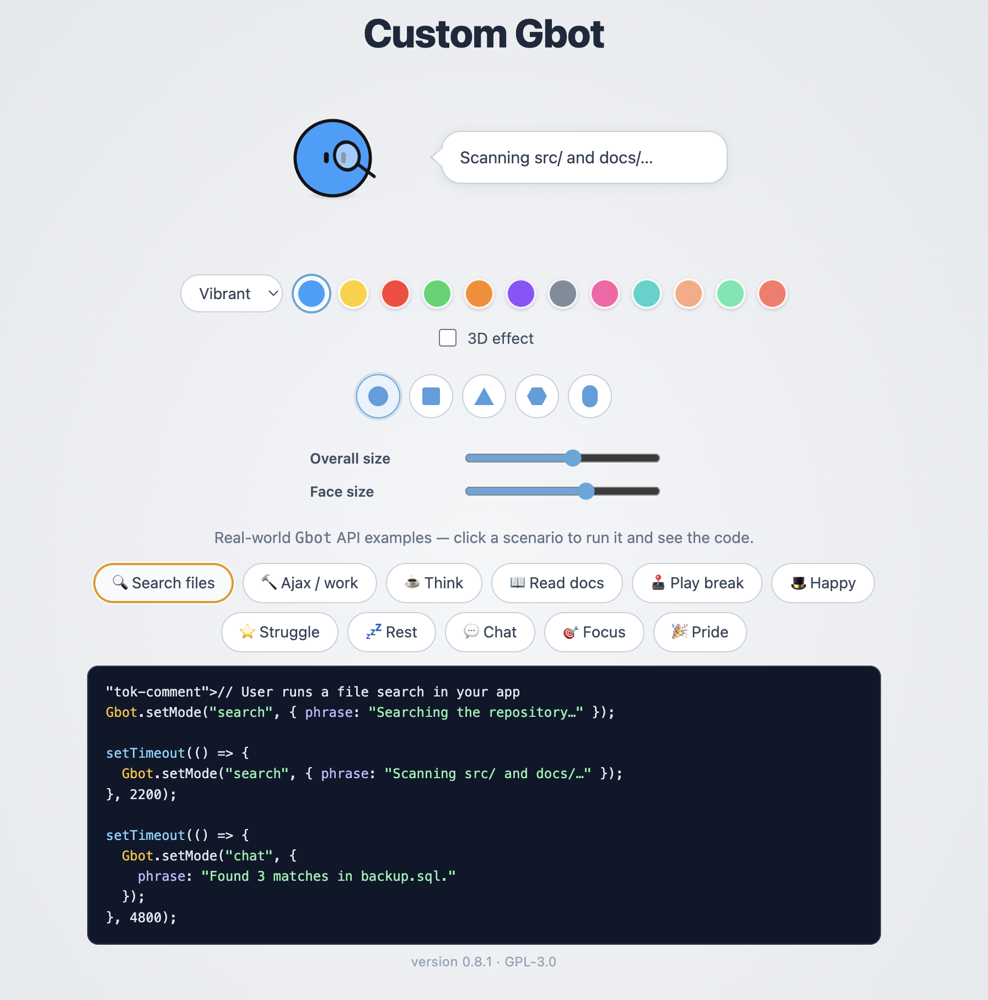

# Custom Gbot



**Gbot** is a small client-side JavaScript library that renders an expressive canvas mascot and drives its moods from your app code. Use it to reflect loading states, errors, focus time, chat replies, and other UX moments—similar to a tiny character API for your product.

The interactive playground lives in `[bot.html](bot.html)` (title: **Custom Gbot**). The library itself is a single file: `[gbot.js](gbot.js)`.

**Current version:** `0.8.1`

## Features

- Canvas bot with gaze tracking, blinks, and rich per-mode animations
- Optional **3D** shading and multiple **body shapes** (round, square, triangle, hexagon, pill)
- Color **styles** (vibrant, pastel, normal) and palette chips
- Public API: `Gbot.init()`, `Gbot.setMode()`, `Gbot.stopMode()`, etc.
- Timed modes (`duration`) and custom status **phrases**
- Same mode + new phrase keeps the animation running (no forced restart)
- Built-in UX rules: short-lived **chat** replies; **rest** after user inactivity when idle


## Quick start

1. Add a canvas and a status element (for the speech bubble text):

```html
<canvas id="bot" width="336" height="336"></canvas>
<p id="status">I'm watching you.</p>
```

1. Include the library and initialize:

```html
<script src="gbot.js"></script>
<script>
  Gbot.init({
    canvas: "#bot",
    status: "#status",
    colorStyle: "vibrant",
    color: "blue",
    effect3d: false,
    shape: "round",
    zoom: 100,
    faceSize: 21,
    welcomePhrase: "I'm watching you."
  });
</script>
```

1. Drive the bot from your logic:

```javascript
Gbot.setMode("work", { phrase: "Saving your changes…" });

fetch("/api/save")
  .then((response) => {
    Gbot.setMode("chat", {
      phrase: `Saved — HTTP ${response.status}.`
    });
  })
  .catch(() => {
    Gbot.stopMode();
  });
```

Open `[bot.html](bot.html)` in a browser (or serve the folder with any static server) to try **real-world demo buttons**; each one runs a scenario and shows the matching API code.

## `Gbot.init(options)`


| Option          | Type                                  | Default     | Description                                                                                                        |
| --------------- | ------------------------------------- | ----------- | ------------------------------------------------------------------------------------------------------------------ |
| `canvas`        | `string` | `Element`                  | `"#bot"`    | Canvas selector or element                                                                                         |
| `status`        | `string` | `Element`                  | `"#status"` | Text container for the bot’s line                                                                                  |
| `colorStyle`    | `"vibrant"` | `"pastel"` | `"normal"` | `"vibrant"` | Palette family                                                                                                     |
| `color`         | `string`                              | `"blue"`    | Color key (`blue`, `yellow`, `red`, `green`, `orange`, `violet`, `gray`, `pink`, `cyan`, `peach`, `mint`, `coral`) |
| `effect3d`      | `boolean`                             | `false`     | 3D-style body shading                                                                                              |
| `shape`         | `string`                              | `"round"`   | `round`, `square`, `triangle`, `hexagon`, `pill`                                                                   |
| `zoom`          | `number`                              | `100`       | Overall canvas scale (`50`–`140`, percent)                                                                         |
| `faceSize`      | `number`                              | `21`        | Face/body radius slider value (`9`–`28`, maps to internal ratio)                                                   |
| `welcomePhrase` | `string` | `null`                     | `null`      | Idle status text; falls back to the built-in idle line                                                             |


`init()` returns an instance object with the same methods as `Gbot` (see below). The global `Gbot` singleton delegates to the last initialized instance.

## API


### `Gbot.setMode(mode, options?)`

Activates a mood. Aliases for the default state: `idle`, `normal`, `default` (all return to idle via `stopMode()`).

**Modes**


| Mode       | Typical use                        |
| ---------- | ---------------------------------- |
| `search`   | Searching, indexing, file lookup   |
| `work`     | Loading, saving, background jobs   |
| `think`    | Decisions, analysis, “please wait” |
| `read`     | Documentation, long-form content   |
| `play`     | Breaks, gamification               |
| `happy`    | Success, celebration               |
| `struggle` | Errors, hard problems              |
| `rest`     | Pause, away state                  |
| `chat`     | Explanations, replies to the user  |
| `focus`    | Deep work, concentration           |
| `pride`    | Milestones, releases               |


`options`


| Field              | Type      | Description                                                                                             |
| ------------------ | --------- | ------------------------------------------------------------------------------------------------------- |
| `phrase`           | `string`  | Custom status text (speech bubble)                                                                      |
| `duration`         | `number`  | Ms until automatic return to idle                                                                       |
| `restartAnimation` | `boolean` | If `false`, same mode keeps running and only the phrase may change (default: restart when mode changes) |


**Examples**

```javascript
// Timed struggle
Gbot.setMode("struggle", {
  duration: 5000,
  phrase: "This edge case is tricky…"
});

// Same mode, new phrase (animation continues)
Gbot.setMode("work", { phrase: "Uploading…" });
Gbot.setMode("work", { phrase: "Almost done…" });

// Chat with custom copy (auto-clears after ~3s when phrase is set)
Gbot.setMode("chat", { phrase: "Here is your summary." });
```


### `Gbot.stopMode()`

Clears any scheduled `duration` timer and returns to **idle** (welcome phrase).

### `Gbot.setPhrase(text)`

Updates the status text without changing mode.

### `Gbot.getMode()`

Returns the current mode id (`"idle"` or one of the modes above).

### `Gbot.configure(options)`

Applies the same fields as `init()` at runtime (colors, shape, 3D, zoom, face size, welcome phrase).

### Instance API

```javascript
const bot = Gbot.init({ /* … */ });
bot.setMode("focus", { phrase: "Writing tests…" });
bot.stopMode();
bot.destroy(); // clears scheduled mode timers
```


## Built-in behavior

- **Chat + custom phrase:** if `setMode("chat", { phrase: "…" })` is used without `duration`, the bot returns to idle after **3 seconds**.
- **Inactivity:** if the user is idle (no pointer/keyboard interaction) for **15 seconds** while the bot is in the default idle mood, it enters **rest**; the next interaction wakes it back to idle (when that rest was triggered by inactivity).
- **Click on canvas:** returns to idle (with the usual transition).


## Optional UI in `bot.html`

The demo page includes color chips, shape picker, 3D toggle, and size sliders wired inside `gbot.js`. Your production page can use **only** the canvas + status + API calls, without those controls.

Mood and accessory toolbar blocks in `bot.html` are commented out; scenarios are demonstrated via the **demo buttons** and `Gbot.setMode()`.

## Project files


| File        | Role                                          |
| ----------- | --------------------------------------------- |
| `gbot.js`   | Library (IIFE, global `Gbot`)                 |
| `bot.html`  | Demo / documentation UI with scenario buttons |
| `README.md` | This file                                     |
| `COPYING`        | GNU GPL v3 license text                       |
| `screenshot.png` | README preview image (demo page)              |


## Browser notes

- Requires a modern browser with **Canvas 2D** and `requestAnimationFrame`.
- Cross-origin `fetch()` (e.g. to `google.com` in the Ajax demo) may be blocked by **CORS**; use your own API origin for real status codes.
- For local testing, serve files over HTTP (`python3 -m http.server`) rather than `file://` if you hit security restrictions.


## License

This project is free software licensed under the **GNU General Public License v3.0** (or later).

See the full license text in [`COPYING`](COPYING).

If you distribute this library or a modified version, you must comply with the GPL v3 terms (source availability, same license, etc.).